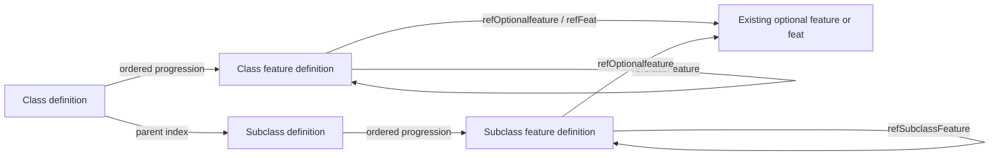

# Feature graph discovery

Status: complete graph of authored roots and explicit references, before inheritance expansion.

Stage B now validates all 2,339 authored structural references and 2,725 effective occurrences after copy inheritance, with zero unresolved/ambiguous own references, cycles or orphans. The source evidence below remains the authored graph; see [STAGE-B-IMPLEMENTATION.md](STAGE-B-IMPLEMENTATION.md).

## Graph boundaries

[feature-graph.json](feature-graph.json) records every root progression reference, nested feature reference, copy target, feature/class/subclass parent, feature markup link, and class/subclass reprint. Edges retain owner and reference JSON pointers, UID, identity, target locators, and resolution status. Relationships are derived only from structured fields and explicit tags. No descriptive mention is converted into a grant.

The repeated feature node arrows describe supported edge types, not cycles found in this dataset. Parent edges in the evidence point from child to parent; the Class → Subclasses index is their inverse.

## Resolution results

| Edge kind | Occurrences | Resolved | Unresolved / ambiguous |
| --- | ---: | ---: | ---: |
| Class → class feature progression | 645 | 645 | 0 / 0 |
| Subclass → subclass feature progression | 1,115 | 1,115 | 0 / 0 |
| Class feature → class feature (`refClassFeature`) | 32 | 32 | 0 / 0 |
| Subclass feature → subclass feature (`refSubclassFeature`) | 547 | 547 | 0 / 0 |
| Explicit feature markup links | 21 | 21 | 0 / 0 |
| Copy targets | 199 | 199 | 0 / 0 |
| Subclass/class feature → parent class | 1,007 | 1,007 | 0 / 0 |
| Subclass feature → parent subclass | 1,499 | 1,499 | 0 / 0 |
| Class/subclass reprints | 90 | 90 | 0 / 0 |

The 2,339 structural feature edges reach all **677 class features and 1,499 subclass features**. There are zero orphan roots, duplicate full feature identities, or dependency cycles. Including feature markup links also produces zero cycles. Parent containment/inverse indexes are excluded from dependency cycle detection. None of these edges crosses a physical file in this snapshot; the resolver must still build corpus-wide indexes rather than assume file locality.

## Definitions, progression, and content

Every class has a `classFeatures` list. Its elements are UID strings (534 occurrences) or wrappers (111): `classFeature` plus `gainSubclassFeature`, `tableDisplayName`, or `gainSubclassFeatureHasContent`. There are 108 explicit subclass advancement flags, three display-name overrides, and one subclass-content flag. These flags configure a reference occurrence and do not mutate its feature definition.

There are 263 authored `subclassFeatures` lists containing 1,115 strings. Sixty-seven copy roots omit this field. Their base relationships are recorded, but Stage A does not materialize inherited lists. A retained UID may intentionally point into the old parent source. Do not rewrite all targets to a subclass copy's new parent context.

Features have explicit numeric `level` values and parent/source identity components. `header` occurs on 19 class features and 1,077 subclass features and is numeric rendering metadata, not a level, parent, or additional definition. Feature roots may themselves use rendering `type` values `item` or `inset`; the root collection still determines their definition kind.

## Choices, requirements, and replacements

Forty nested `options` objects occur: 25 have an explicit `count`, 12 omit it, and three use a `style` field. Preserve option grouping, order, explicit count versus absence, and target references. Do not equate missing count with one or flatten all children into simultaneous grants.

`refOptionalfeature` occurs 161 times, with optional `name`, `preserve`, and `data.isRequiredOption` metadata. Optional progression has one further required UID (`Elemental Attunement`) at level 3. All 162 resolve to the existing Optional Features corpus. Two `refFeat` nodes resolve to XPHB feats. These are independent catalogs, not additional class feature definitions.

The `isClassFeatureVariant` flag occurs on 29 class features and 20 subclass features. It marks variants without a structured replacement-target field. No explicit replacement edge can be established from prose such as “replaces” or a matching level/name. Keep the flag and content internally; expose variant classification without inventing replacement mechanics.

## Copy and edition relationships

Seventy-five subclass features explicitly copy earlier PHB-parent features into XPHB-parent contexts, sometimes changing level 1 or 2 to level 3. They remain independent definitions. No class feature copies or feature `_versions` occur. PHB feature names and source codes must survive adaptation; source and parent edition are separate.

## Architecture decision

Use independently addressable Class Feature and Subclass Feature definitions. Their stable identities, explicit reference nodes, nested sharing, and separate root collections support this directly. Keep reference occurrence configuration and choice groups on the owner. Retrieve feature content by reference rather than recursively duplicating it in every class/subclass response. Do not combine these definitions with Optional Features.
