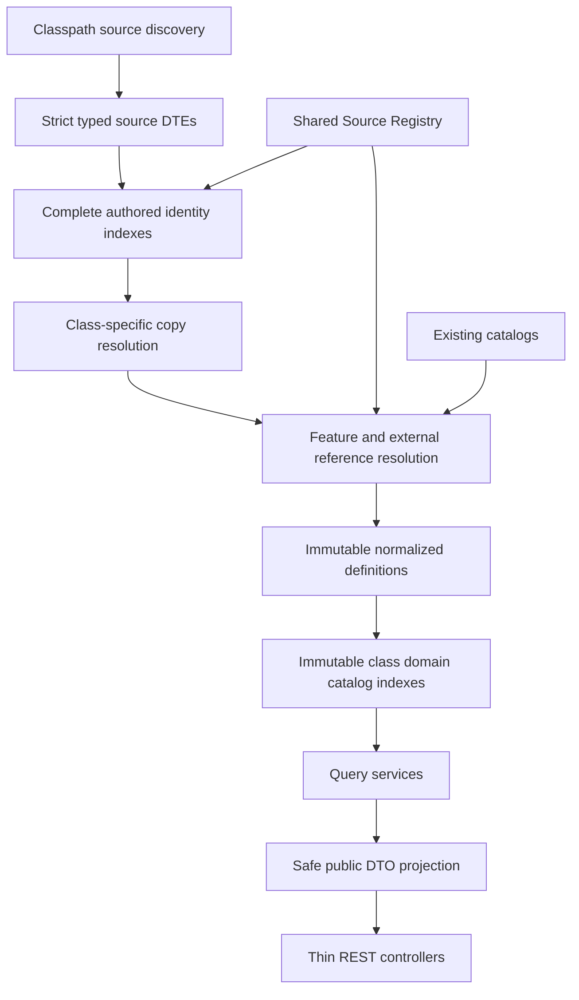

# Proposed normalized class architecture

Status: Stage A architecture, with the internal portion implemented in Stage B and the public catalogs/API implemented in Stage C. See [STAGE-B-IMPLEMENTATION.md](STAGE-B-IMPLEMENTATION.md) and [STAGE-C-IMPLEMENTATION.md](STAGE-C-IMPLEMENTATION.md) for final components and projection boundaries.

## Pipeline and ownership

There are no version declarations in the snapshot, so the planned resolver need not implement speculative templates. Unknown transformation fields must produce strict failures and diagnostics. The loading boundary must work inside a packaged Spring Boot JAR: use a recursively discovered classpath resource pattern or a build-generated resource list with exact inventory validation. Never enumerate only an operating-system directory or assume an upstream manifest exists.

## Four independent definition kinds

| Proposed type | Components |
| --- | --- |
| `ClassDefinition` | `ClassId id`, `String name`, `SourceReference source`, `String declaredEdition`, `Boolean sidekick`, optional `HitDice`, saving throw ability list, grouped primary abilities, `ClassStartingOptions`, `ClassMulticlassOptions`, ordered `ClassFeatureUnlock` list, `ClassSpellcasting`, optional/feat progression groups, owned progression tables, secondary sources, typed reprint references |
| `SubclassDefinition` | `SubclassId id`, `String name`, `String shortName`, `SourceReference source`, `ClassId parentClassId`, parent name/source reference, optional declared/inherited edition facts, ordered `SubclassFeatureUnlock` list, optional spellcasting, optional/feat progression groups, owned tables, secondary sources, typed reprint references |
| `ClassFeatureDefinition` | `ClassFeatureId id`, name/source, exact parent class identity/ID, integer level, optional variant flag, optional `FeatureConsumption`, structured feature content graph |
| `SubclassFeatureDefinition` | `SubclassFeatureId id`, name/source, exact parent class and subclass identities/IDs, integer level, optional variant flag, optional `FeatureConsumption`, structured feature content graph |

Use shared `SourceIdentity` and `SourceReference` in all applicable components. IDs follow [IDENTITY-ANALYSIS.md](IDENTITY-ANALYSIS.md). Names, sources, parent context, and levels are sufficient for collision-free IDs in the complete current corpus. A feature's parent context is its own authored context, which can differ from the owner referencing it.

The four definition types have separate indexes and are independently addressable. A single class-domain loading coordinator may atomically publish all four catalog views to avoid startup dependency cycles. Suggested responsibilities are `ClassesSourceLoader`, `ClassCopyResolver`, `ClassReferenceResolver`, `ClassDefinitionNormalizer`, and `ClassesCatalogLoader`, with immutable `ClassCatalog`, `SubclassCatalog`, `ClassFeatureCatalog`, and `SubclassFeatureCatalog` views. These are architectural responsibilities, not a requirement to create one framework component for every step.

No database, JPA model, character object, selected subclass, current level, inventory, current spell slots, or generic rules engine belongs here.

## Import structures

Proposed source roots: `ClassesFileDte`, `ClassDte`, `SubclassDte`, `ClassFeatureDte`, and `SubclassFeatureDte`, plus typed `_meta`, kind-specific copy declarations, proficiency, equipment, table-cell, and spell-grant structures. One public top-level type per Java source file. Strict unknown-field behavior is mandatory at every nested custom-deserializer boundary.

Import structures preserve source spelling, empty UID slots, optionality, field order where meaningful, explicit empty values, raw rich text, and source rendering metadata. There are zero explicit nulls in the current snapshot; future null behavior should remain distinct from absence when copy overrides depend on it. Do not normalize absent lists into explicit empty override lists before copy resolution.

The existing `dte.common.entry.EntryDte` hierarchy is useful precedent but **cannot deserialize this corpus unchanged**. It lacks `refClassFeature`, `refSubclassFeature`, `refOptionalfeature`, `refFeat`, `options`, `abilityDc`, `abilityAttackMod`, and `statblock` entry kinds. The class corpus also adds fields such as list `page`, optional reference `preserve`, and options `style`; these need explicit coverage. Quotes without `by` and named blocks without `name` can already be represented by the existing optional components. Design a class-specific typed entry hierarchy or make narrowly justified shared extensions with regression coverage; do not disable validation globally.

Similarly, Background equipment DTEs do not include observed `equipmentTypes` arrays. Existing Race or Feat spell grant node trees preserve source shape but do not provide the final semantic class spell model. Reuse exact compatible value types, not loosely similar deserializers.

## Owned value types and sealed variants

| Concept | Proposed components / variants |
| --- | --- |
| Feature unlock | Verified feature reference, explicit level, source order, optional `gainSubclassFeature`/content flag, internal table display override |
| Feature structure | Ordered `FeatureReferenceNode`, `OptionalFeatureReferenceNode`, `FeatReferenceNode`, `FeatureOptionGroup`, typed ability DC/attack declarations, internal descriptive/presentation nodes |
| Feature option group | Optional explicit count, ordered child options, required-option flags; missing count remains unspecified |
| Feature consumption | Resource name token; optional exact amount or min/max amount; unresolved resource binding is retained |
| Level values | Immutable ordered `LevelCount(level,count)` sequences; absent sequence distinct from authored zeros |
| Choice progression | Name, typed target catalog/category selector, level-count milestones, required references; dense/sparse source form in provenance |
| Progression table | Owner-local group order, optional title/column metadata, row-level association, explicit row kind, typed cells, optional subclass selectors |
| Table cell | `NumericCell`, internal `PresentationTextCell`, `BonusCell`, `DiceCell`, `SpeedBonusCell`; no generic `Object` or lossy string flattening |
| Ability requirement | Grouped `AllOf`/`AnyOf` thresholds derived from the observed source grammar; never evaluate a character |
| Proficiency option | Fixed ability/skill/tool/category grants or category/name choice with count and alternatives; display text retained internally |
| Equipment group | Ordered unconditional bundle or labeled alternative branches; each branch has ordered equipment entries |
| Equipment entry | `ItemEquipment`, `ItemGroupEquipment`, `EquipmentCategoryChoice`, `EquipmentCategoryAlternatives`, `CurrencyEquipment`, `UnboundSpecialEquipment` |

Tables and starting option groups have owner-local identity/order; there is no evidence of globally reusable table definitions, so no independent table catalog is proposed. Preserve every structured table, including numeric values whose mechanical column meaning cannot be established. Public projection may be narrower.

## Spellcasting model

`ClassSpellcasting` components: source caster code, optional ability, cantrip/known/prepared level-count progressions, optional validated symbolic prepared expression, preparation-change code, fixed-known progression, fixed-by-class-and-spell-level progression, allow-lower-level flag, slot matrices, owned Pact table data, and ordered additional spell grant groups.

`AdditionalSpellGrantGroup` carries optional group name/ability/resource name and ordered grants. `SpellGrant` carries category (`KNOWN`, `PREPARED`, `EXPANDED`, `INNATE`), a typed level gate, typed usage specification, and ordered spell references or selectors. Gate variants distinguish class levels from `sN` spell-level gates. Usage variants distinguish unspecified, daily, rest, ritual, and resource-cost structures, preserving numeric/ability/count qualifiers rather than treating all keys as numbers.

`SpellReference` retains name, optional explicit source, and optional source configuration suffix; no `SpellId` exists yet. `SpellSelector` separates choose/all, optional count, unrestricted selectors, and typed clauses for observed class/level/school/source constraints. The complete original selector belongs to import/provenance; public JSON gets a safe typed form only. A small symbolic preparation expression AST can preserve level, ability modifier, addition, and division without choosing rounding or evaluating a character.

No generalized effect, recharge, ritual, spell-focus, or resource-pool rule is inferred from prose. A class with spell grants need not have slots. A source caster code without an ability does not authorize an invented ability choice.

## Source-field destinations

Every one of the 729 paths is retained in a typed import tree; mapping review must reconcile it against [normalized-field-inventory.json](normalized-field-inventory.json). The following covers every root field family and establishes the default destination for its descendants.

| Observed fields | Internal destination | Public projection |
| --- | --- | --- |
| `name`, `shortName`, `className`, `classSource`, `subclassShortName`, `subclassSource`, `source`, `level` | Source-aware definition/reference identity | Identity, parent references, level |
| `page`, `otherSources`, `reprintedAs` | Shared source occurrences and typed reprint relationships | Lightweight safe source/reprint references |
| `edition`, `isSidekick`, `isClassFeatureVariant` | Distinct declared classification facts | Classification without inferred edition migration |
| `hd`, `proficiency`, `primaryAbility`, `startingProficiencies`, `multiclassing` | Hit dice, grouped ability/proficiency options and requirements | Typed mechanics; no descriptive constraints inferred |
| `startingEquipment` | Typed group tree plus internal display/gold prose | Structured choices, item/group identities, quantities and copper values |
| `classFeatures`, `subclassFeatures` | Ordered unlocks and reference configuration | Verified references/levels; display overrides internal |
| `classTableGroups`, `subclassTableGroups` | Complete typed owned tables | Explicit slot matrices and approved typed cells/columns only |
| `optionalfeatureProgression`, `featProgression` | Distinct target-kind/category progression groups | Source choices and milestone counts |
| All cantrip, caster, known, prepared, fixed spell progression/change/ability fields; `additionalSpells` | Typed spellcasting and grant structures | Safe mechanics and deferred typed spell identities/selectors |
| `consumes` | Feature consumption declaration | Name token and explicit amount/range |
| `entries` | Typed content tree with extracted explicit reference/option/DC/attack nodes | Structured nodes only; prose stays internal |
| `subclassTitle`, `header`, root rendering `type`, table labels/styles | Presentation data | Only independently approved labels; no raw rendering instructions |
| `fluff`, `hasFluff`, `hasFluffImages` | Internal description/media metadata | Excluded |
| `srd`, `srd52`, `basicRules`, `basicRules2024`, `isReprinted` | Source publication/classification flags, not inferred licenses | Excluded unless an explicit publication decision requires them |
| `_meta`, `_copy`, `_preserve` | Import directives and lineage | Excluded |

Nested `data`, `genTables`, `tableInclude`, `preserve`, style, and renderer fields remain internal except the explicit `data.isRequiredOption` choice fact. Descriptive strings inside mechanically structured parents remain descriptive; they do not bypass the public projection simply because of their location.

## Catalog invariants and diagnostics

At startup: account for every discovered file/root; validate Source Registry references; resolve copy dependencies; verify unique tuples/IDs; resolve all own feature and parent identities; preserve all 199 copy roots; retain all 2,176 features including any future orphans; keep unresolved foreign references with typed identities and internal diagnostics; sort/index deterministically; publish immutable views only after successful own-domain validation.

Foreign spell binding is expected to be deferred. Item-group choices need a defined reference form before public character equipment workflows use them. Unqualified skill/tool identities remain unqualified. A feature with only prose still has a valid independent identity and a minimal public detail representation.

## Decisions tracked into implementation

Stage B implements four independent definition kinds, readable full-context IDs and typed unresolved foreign references. It uses class-specific entry types and the protected metadata policy in [COPY-RESOLUTION-SPEC.md](COPY-RESOLUTION-SPEC.md). Stage C exposes safe structured projections and deferred item-group references while keeping file metadata, typed authored/effective source records, and descriptive feature content internal. See [STAGE-C-IMPLEMENTATION.md](STAGE-C-IMPLEMENTATION.md) for current API limitations.
