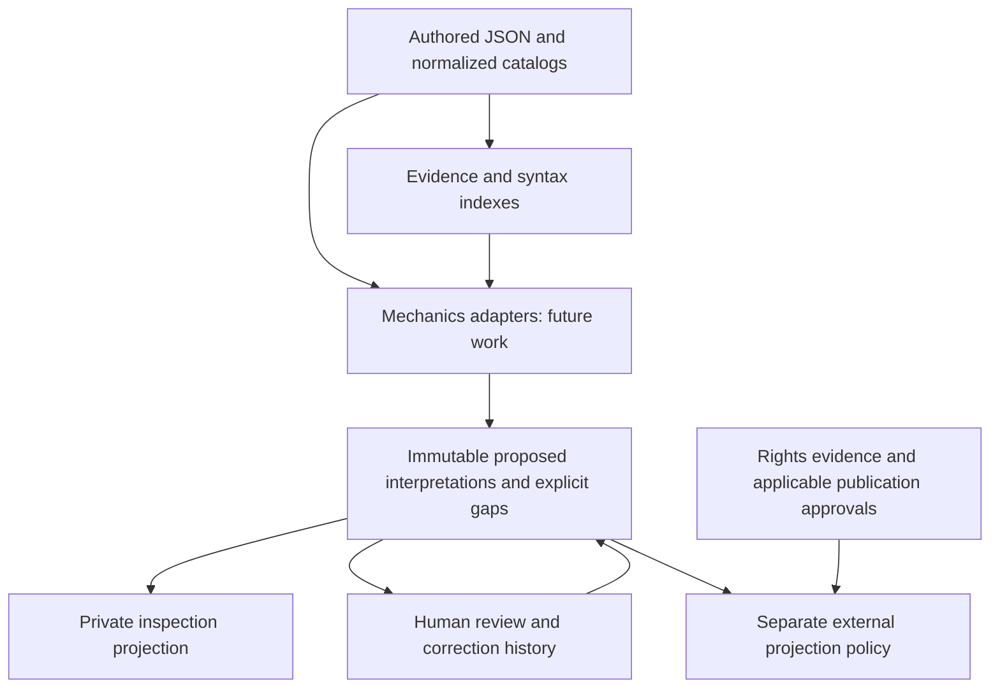

# 7.2.1 — Mechanics data model and REST contract

**Status:** design complete; no production implementation or extracted mechanics are delivered here.
The proposed contracts below guide separately authorized 7.2.2 and 7.2.3 work. The current baseline
remains 561 reported passing tests, 969 Spell identities, 930 authored formula observations,
6,246 resolver outcomes and 175 pinned source JSON files. Maven was not rerun for this design batch.

## 1. Architecture and decisions

Mechanics interpretation is the priority. Preserve five distinct layers:

1. **Source and observations:** immutable DTEs, normalized catalogs, explicitly authored fields,
   Batch 5 syntax evidence and Batch 6 formula observations. These remain the original evidence.
2. **Interpretations:** typed, source-backed claims about what a rule means, including partial claims.
3. **Quality and review:** deterministic findings, benchmark results and independently recorded human decisions.
4. **Rights assessment:** documented coverage of each exact claim under a license or other established basis.
5. **Projection policy:** server-selected inspection or externally releasable views of the same canonical claims.



P1D is not an input filter for adapters, canonical storage or private inspection. `NEEDS_REVIEW`
rights do not hide a proposed mechanic from the owner's private-network API. This user-authorized
inspection boundary supersedes the earlier *release-projection* restriction on locators for this
new inspection view only. It does not modify P1D or authorize internet publication.

**Recommended API decision:** extend Spell detail with an opt-in nullable `interpretedMechanics`
envelope. Preserve the existing `mechanics` classification object, all other fields and ordinary
responses. No independent competing Spell model or separate mechanics endpoint is needed initially.

**Recommended modeling decision:** a common immutable envelope around small sealed payload families,
with catalog adapters and evidence-backed context bindings. This is a descriptive representation.
It has no evaluator, character state, event dispatcher, stacking calculator or generic executable effect AST.

## 2. Repository evidence and current coverage

Paths in this section are actual current code; proposed types elsewhere do not yet exist.

| Pipeline / model | What is already retained | Consequence for this design |
|---|---|---|
| [SpellDte](../../../src/main/java/com/thedndpub/data/dte/spell/SpellDte.java) → [SpellDefinitionNormalizer](../../../src/main/java/com/thedndpub/data/importer/spell/SpellDefinitionNormalizer.java) → [SpellDefinition](../../../src/main/java/com/thedndpub/data/dto/spell/SpellDefinition.java) | Source-aware ID, `castingTimes`, `range`, `components`, `durations`, `ritual`, `mechanics`, `scaling`, entries and source relationships | Keep these definitions authoritative; adapters reference existing values and source paths |
| [SpellMechanics](../../../src/main/java/com/thedndpub/data/dto/spell/SpellMechanics.java) → [SpellMechanicsDto](../../../src/main/java/com/thedndpub/data/dto/spell/api/SpellMechanicsDto.java) | Twelve classification lists, including `savingThrows`, `spellAttacks`, `conditionsInflicted`; `damageInflicted` projects as `damageTypes` | A classification is not an effect, target, imposed condition or formula/type relationship |
| [SpellPublicMapper](../../../src/main/java/com/thedndpub/data/dto/spell/api/SpellPublicMapper.java) | Range/distance, component flags and reviewed material subset, duration alternatives, scaling; casting qualifiers become `hasCondition`/`hasNote` | Keep all existing projections; the exact reaction condition is currently internal |
| [SpellDto](../../../src/main/java/com/thedndpub/data/dto/spell/api/SpellDto.java) / [SpellSummaryDto](../../../src/main/java/com/thedndpub/data/dto/spell/api/SpellSummaryDto.java) | Existing detail and summary contracts; detail has nullable `formulaProjectionStatus` | Append a separate envelope later; never replace `mechanics` with a list |
| [SpellFormulaAnnotation](../../../src/main/java/com/thedndpub/data/dto/spell/SpellFormulaAnnotation.java) / [index](../../../src/main/java/com/thedndpub/data/dto/spell/SpellFormulaAnnotationIndex.java) | Existing Spell ID, per-owner occurrence index, section, exact tag and `SyntaxEvidence` | Reference these observations; do not make a new parser or interpret `damage` as an applied effect automatically |
| [SpellFormulaProjectionCatalog](../../../src/main/java/com/thedndpub/data/services/SpellFormulaProjectionCatalog.java) | Startup owner reconciliation; 547 NONE_OBSERVED / 422 WITHHELD | This is formula **publication** completeness, not mechanics completeness |
| [SpellsController](../../../src/main/java/com/thedndpub/data/controllers/SpellsController.java) / [SpellsService](../../../src/main/java/com/thedndpub/data/services/SpellsService.java) | Detail by ID; by-name returns a list; collection returns summaries with existing filters | Preserve route behavior, multiplicity and source-aware lookup |
| [FeatMechanics](../../../src/main/java/com/thedndpub/data/dto/feat/FeatMechanics.java), [ItemSignedBonus](../../../src/main/java/com/thedndpub/data/dto/item/ItemSignedBonus.java), [ItemChargeDto](../../../src/main/java/com/thedndpub/data/dto/item/ItemChargeDto.java), [ClassFeatureAbilityDeclaration](../../../src/main/java/com/thedndpub/data/dto/classes/ClassFeatureAbilityDeclaration.java) | Existing narrow typed grant, bonus, resource and ability structures | Reuse matching leaves through adapters; no migration or blanket equivalence across catalogs |
| [ObjectEvidenceMembership](../../../src/main/java/com/thedndpub/data/dto/object/evidence/ObjectEvidenceMembership.java) | Proven containment with exact evidence boundaries | Membership is evidence for containment, not sufficient evidence for damage or target semantics |
| [MonsterSyntaxAnnotationCatalog](../../../src/main/java/com/thedndpub/data/services/MonsterSyntaxAnnotationCatalog.java) | Authored Monster observations indexed separately from effective definitions | Shared evidence vocabulary is reusable; transformed/effective provenance must not be inferred |
| [SpellPublicationCatalog](../../../src/main/java/com/thedndpub/data/services/SpellPublicationCatalog.java) / [validator](../../../src/main/java/com/thedndpub/data/publication/spell/SpellPublicationValidator.java) | Separate candidate/evidence/decision/notice validation, zero authorizations | Retain unchanged; do not use it to remove internal proposals |

The [Batch 6 report](../batch-6-spell-formulas/IMPLEMENTATION.md) reconciles 642 `damage`,
126 `dice`, 148 `scaledamage` and 14 `scaledice` observations on 422 owners. It also retains
18 auxiliary modifier/label observations separately. Existing 41 `scalingLevelDice` roots and
78 numeric non-point range geometries are not missing mechanics to re-extract. The 930 count
is authored syntax coverage, not an effective-provenance or interpreted-effect count.

### 2.1 Selected source cases inspected

These are reproducible source observations, not an independently reviewed interpretation gold set.
Resources are relative to `src/main/resources/`; spans index decoded Java strings in UTF-16.

| Case | Root and relevant fields | Confirmed distinction / proposed benchmark focus |
|---|---|---|
| Shield PHB, p.275 | `data/spells/spells-phb.json#/spell/294`; `/time/0/condition`, `/entries/0`, `/duration/0` | `+5` at entries string span `[110,112)`; reaction condition has two alternatives; body contains unqualified `{@spell magic missile}`; duration metadata is one round, prose names a turn boundary |
| Shield XPHB, p.316 | `data/spells/spells-xphb.json#/spell/304`; same relative fields | `+5` at `[102,104)`; condition explicitly says attack **roll** and uses plain Magic Missile text; body has source-qualified `{@spell Magic Missile|XPHB}` |
| Fireball PHB, p.241 | PHB `/spell/139/entries/0`, `/entries/1`, `/entriesHigherLevel/0/entries/0`, `/damageInflict/0`, `/savingThrow/0` | `{@damage 8d6}` span `[262,275)`; type, area and save outcomes require clause association; higher-level tag is separate syntax |
| Healing Word PHB, p.250 | PHB `/spell/175/entries/0`, `/entriesHigherLevel/0/entries/0`, `/affectsCreatureType` | `{@dice 1d4}` at `[84,95)`; spellcasting modifier is outside the tag; target and creature exclusions must not disappear |
| Prestidigitation PHB, p.267 | PHB `/spell/260/entries/1/items/0` through `/5`, `/entries/2` | Six authored list items and a separate concurrent-effect/dismissal clause; a Shield-only adapter may support none of these |
| Magic Missile PHB, p.257, negative/control source | PHB `/spell/213/entries/0`, `/entriesHigherLevel/0/entries/0` | A formula does not encode projectile count, distribution, simultaneous timing or the incremental projectile rule |

The PHB resource SHA-256 is `c9e54cce55e7ce0fc988feb1b604bf505faa5c042635542fa6b6ed36724e297a`.
The XPHB resource SHA-256 is `442544a91aad1181cbad78d49cfa48f9ced7d8b048dbc781e32fa6fefc6278b9`.
Both Shield roots have zero Batch 6 formula observations. No source flag establishes rights for
the proposed claims. The two reaction conditions must be read independently; an explicit XPHB
qualifier in the body must not be retroactively assigned to its plain-text casting condition.

## 3. Canonical model

### 3.1 Envelope and channels

Proposed packages: `mechanics.model` for canonical immutable values, `mechanics.review` for
review events, `mechanics.inspection` for DTOs, and catalog-specific adapters. Existing
`mechanics.syntax`, normalized definitions and `publication.spell` remain unchanged.

Illustrative Java declarations below are design signatures, not Java files. Referenced value types
are specified in the following tables. Every implemented type must occupy its own source file.

```java
public record MechanicsDocument(
        MechanicsOwnerReference owner,
        MechanicsDocumentRevision revision,
        List<SourceArtifactRevision> sources,
        MechanicsProcessing processing,
        List<MechanicRecord> interpretations,
        List<MechanicsObservationReference> observations,
        List<UnsupportedMechanicsConstruct> unsupported,
        List<MechanicsEvidence> evidence,
        MechanicsCoverage coverage,
        MechanicsReviewSummary reviewSummary) {
    public MechanicsDocument {
        sources = List.copyOf(sources);
        interpretations = List.copyOf(interpretations);
        observations = List.copyOf(observations);
        unsupported = List.copyOf(unsupported);
        evidence = List.copyOf(evidence);
    }
}

public record MechanicRecord(
        MechanicId id,
        MechanicRevision revision,
        MechanicPayload payload,
        MechanicContext context,
        List<MechanicEvidenceAssociation> evidenceAssociations,
        MechanicDerivation derivation,
        MechanicsAssessment assessment,
        MechanicsReviewState review,
        MechanicsLicensing licensing) {
    public MechanicRecord {
        evidenceAssociations = List.copyOf(evidenceAssociations);
    }
}

public sealed interface MechanicPayload permits
        ArmorClassModifierMechanic,
        AttackModifierMechanic,
        SavingThrowModifierMechanic,
        ReactionActivationMechanic,
        EffectDurationMechanic,
        SpellDamagePreventionMechanic,
        DamageMechanic,
        HealingMechanic,
        SavingThrowRequirementMechanic {
}
```

The permits list is the proposed initial passive vocabulary, not a promise to extract nine families
in 7.2.2. Future families require new narrow records and their own reviewed source/gold cases.
DTOs use a closed `kind` discriminator with explicit Jackson subtype names; do not enable global
default typing or emit Java class names. Exhaustive consumers must handle future schema versions.

| Proposed supporting type | Contract |
|---|---|
| `MechanicsOwnerReference(CatalogDomain domain, String id, SourceReference source)` | Validate against the existing catalog's ID and Source Registry; no new catalog identity; reuse `SourceIdentity`/`SourceReference` |
| `MechanicsDocumentRevision(long number, String contentSha256)` | Snapshot of selected interpretation revisions, evidence, assessment/review/rights revisions and projection inputs; distinct from source revision |
| `MechanicRevision(long number, String contentSha256, MechanicRevisionReference supersedes)` | Monotonic within a mechanic; digest binds payload, context, evidence, source revisions and derivation; optional predecessor is explicit |
| `MechanicsProcessing(ProcessingState state, String adapterId, String adapterVersion)` | `NOT_ATTEMPTED`, `PROCESSED`, `FAILED`; no empty-result success on failure |
| `MechanicsObservationReference` sealed variants | `StructuredDeclarationReference` points to an existing normalized property and original source field; `FormulaObservationReference(SpellId,int,SourceArtifactRevision)` points to Batch 6; `OtherSyntaxObservationReference` preserves syntax identity/category without asserting effects |
| `UnsupportedMechanicsConstruct` | Local stable issue ID, candidate family, controlled reason code, evidence references, optional alternative revision references and required review action; never a fabricated effect |
| `MechanicsCoverage` | `NOT_ASSESSED`, `NONE_SUPPORTED`, `PARTIAL`, `COMPLETE_WITHIN_SCOPE`; names its exact adapter/pattern scope, considered sections, omitted/failed sections and unresolved issue count |

At least one substantive supported assertion and nonempty evidence are required for an interpreted
record. A recognized formula with no established role remains an observation. A wholly unknown
effect remains an unsupported construct, not a `DamageMechanic` filled with nulls.

`COMPLETE_WITHIN_SCOPE` means all obligations of a named, versioned extraction scope were accounted
for. It never means the entire D&D rule or Spell is fully modeled. Unsupported source sections remain
visible, and global completeness is unknown unless independently inventoried. Zero records after
no adapter ran means NOT_ASSESSED, not NONE_SUPPORTED and not “no mechanical effects.”

### 3.2 Payloads, amounts and context

| Family / proposed record | Narrow fields and constraints | Priority |
|---|---|---|
| `ArmorClassModifierMechanic(ModifierAmount amount)` | Exact signed value or explicitly supported symbolic amount; context identifies subject and triggered-attack inclusion | Shield pilot first |
| `AttackModifierMechanic(AttackSelector appliesTo, ModifierAmount amount)` | Attack category/selector is explicit or unknown; not a computed attack bonus | Later adapter; passive vocabulary only initially |
| `SavingThrowModifierMechanic(AbilitySelection appliesTo, ModifierAmount amount)` | Specific/all/choice ability selection retained; not a requirement to roll a save | Later adapter |
| `ReactionActivationMechanic(ActionCost cost, TriggerExpression trigger)` | Ordered ANY/ALL groups of supported trigger leaves; preserve alternatives; no trigger evaluation | Shield pilot first |
| `EffectDurationMechanic(DurationSpecification specification)` | `DeclaredSpellDurationReference` to an existing duration; `FixedDuration`; `UntilTurnBoundary`; explicit unknowns | Shield turn boundary first; no blanket application to all effects |
| `SpellDamagePreventionMechanic(SpellMentionReference spell)` | Narrow no-damage-from-a-named-spell interaction; not force immunity or general spell immunity | Shield pilot candidate; abstain on unresolved applicability |
| `DamageMechanic(AmountExpression amount, DamageTypeSelection damageType)` | Role must be established separately from a damage tag; retain unknown/choice types; subject/outcome links are separately evidenced | Fireball after Shield benchmark |
| `HealingMechanic(AmountExpression amount, HealingMode mode)` | HP restoration distinct from temporary HP; symbolic modifiers preserved | Healing Word after role/formula review |
| `SavingThrowRequirementMechanic(AbilitySelection ability, SaveDifficulty difficulty)` | Requirement distinct from modifiers/classifications; `UnknownSaveDifficulty` when DC basis is not established | Fireball after Shield |
| `SavingThrowOutcomeMechanic(MechanicRevisionReference savingThrow, SaveOutcome outcome, SaveOutcomeRule rule)` | Later narrow rules can reference an existing effect or state HALF_DAMAGE_OF that effect; do not calculate a new formula or pair by proximity | Separate outcome gold cases; not in initial permits list |
| `ConditionChangeMechanic(ConditionOperation operation, ConditionMentionReference condition)` | APPLY, REMOVE or END; reference/label alone never establishes operation | Later investigation |
| `TemporaryHitPointsMechanic(AmountExpression amount)` | Separate family; no automatic healing or duration equivalence | Later investigation |
| `MovementChangeMechanic(MovementMode mode, SpeedChange change)` | `SetSpeed`, `AddSpeed`, `MultiplySpeed`, `GrantMovementMode`; explicit units and constraints | Later investigation |
| `DamageDefenseMechanic(DefenseKind kind, DamageTypeSelection types)` | RESISTANCE, IMMUNITY or VULNERABILITY; conditional context is mandatory when authored | Later investigation |
| `ConditionDefenseMechanic(ConditionSelection conditions)` | Distinct from damage defense and condition removal | Later investigation |
| `ResourceExpenditureMechanic(ResourceReference resource, AmountExpression amount)` / `ResourceRestorationMechanic(...)` | Distinct resource owner, pool/slot/charge kind and amount; unknown pool stays unknown; reset/timing is not guessed | Later Item/feature evidence work |
| `ActionCostMechanic(ActionCost cost)` / `TriggeredResponseMechanic(TriggerExpression trigger)` | Actions, bonus actions and reactions are distinct; recharge is not action cost | Extend after Shield |
| `ConcentrationRequirementMechanic(ConcentrationRequirement requirement)` | Explicit required/not-required/unknown; absent concentration field is not false | Structured adapter later |
| `TargetingMechanic(TargetSelector selector)` / `AreaOfEffectMechanic(AreaShape shape, DistanceValue extent, AreaOrigin origin)` | Range, reach, area and eligible target selection are distinct; preserve limits, alternatives and unknowns | Narrow shapes later |
| `ScalingMechanic(ScalingAxis axis, ScalingSchedule schedule)` | Slot level vs character level vs class level; existing Spell scaling reference, explicit schedule or reviewed increment; no evaluation | Structured schedules before prose scaling |
| Summoning / creation / transformation | Separate eventual payloads with explicit entity/reference, quantity, ownership, form and lifetime; no universal entity-change record yet | Requires independent family audits |
| `RollModeMechanic(RollSelector roll, RollMode mode)` | ADVANTAGE/DISADVANTAGE only with explicit roll scope and conditions | Later investigation |
| Other special/conditional interactions | Add bounded types case by case; otherwise unsupported with evidence | Defer generic effect/predicate language |

`ModifierAmount` reuses the semantics of an authored signed integer, not necessarily the Item-specific
record. It distinguishes `IntegerModifier(value, authoredToken)` from `SymbolicModifier(symbol)`.
The exact authored token is optional only for genuinely structured numeric input that had no string
token. Do not create one from a public display string.

`AmountExpression` is a sealed value vocabulary: `IntegerAmount`, `DiceAmount(count,sides,modifier)`,
`SymbolicAmount(symbol)`, `SumAmount(terms)` and `UnknownAmount(reason)`. It is not an arithmetic
engine. Keep the original formula observation reference alongside a parsed value. Reject or retain
opaque syntax as observations if the bounded grammar cannot parse it; do not simplify or evaluate it.
An authored average is a separate value, not a replacement for dice. Dice count/sides and amounts
have domain validation, meaningful zero survives, and exact rational/decimal types replace floats
where fractional values are actually supported. Additional operators require corpus evidence.

`MechanicContext(SubjectReference subject, List<MechanicContextBinding> bindings)` contains narrowly
typed bindings, including `ActivatedBy`, `AppliesForDuration`, `AppliesOnSaveOutcome`,
`IncludesTriggeringAttack`, `ChoiceMembership` and later reviewed restrictions. Subject is explicitly
`CASTER`, an evidenced target selector reference or `UNKNOWN`; missing never defaults to caster.
Bindings can carry a narrow inline value (such as a turn-boundary duration) or pin a separately
represented mechanic ID **and revision**; both carry their own evidence associations. Their semantics
are included in the enclosing record's revision and human review scope. A reviewer verifying a formula
alone does not verify its subject, trigger, timing or outcome associations.

Initial trigger leaves include `HitByAttackTrigger(AttackEventKind)` and
`TargetedBySpellTrigger(SpellMentionReference)`. PHB's authored attack wording and XPHB's explicit
attack-roll wording remain distinguishable; do not silently equate their formal definitions.
ANY/ALL preserve group membership and order. This small description of an authored condition does
not authorize arbitrary Boolean scripts or an event engine.

Catalog references preserve authored token/name, source qualification **if authored**, relationship
role, resolution disposition and optional authoritative target ID. The initial dispositions include
`NOT_ATTEMPTED`, `RESOLVED`, `AMBIGUOUS`, `UNRESOLVED`, `UNSUPPORTED`. Existing resolver outcomes can
be adapted where they already exist. No new occurrence is appended to the 6,246 baseline here or
in 7.2.2/7.2.3. Plain prose mentions do not acquire target IDs from matching names. A qualified body
tag cannot qualify a different plain-text trigger by proximity.

### 3.3 Stable identity and ordering

- Proposed readable mechanic identity: `mechanic:<existing-owner-id>:<stable-slot-key>`, e.g.
  `mechanic:spell:phb:shield:ac-bonus`. PHB and XPHB are separate owners and mechanic histories.
- A reviewed pattern defines immutable, owner-local slots such as `ac-bonus` and
  `reaction-activation`. They identify claims, not calculated values or review states.
- Multiple same-family claims need distinct stable slots. For uncurated discovery use a deterministic
  anchor digest over the owner, authored locator and stable rule subclaim key; audit collisions and
  fail on duplicates. Do not use a filtered-array position or the amount itself as identity.
- Locator-derived discovery keys are stable within a pinned snapshot, not guaranteed across source
  edits. A moved/split/merged claim requires an explicit reviewed continuity mapping. Never guess
  continuity from the same name or value. Corrections to an established claim retain its mechanic ID.
- `MechanicRevision` changes for payload, scope/context, evidence, source or derivation changes;
  review/rights events bind its exact digest. Document revisions also change when those events change.
- Preserve source/container order, then declared pattern subclaim order. Store a separate order key;
  do not sort by licensing/review status or encode ordering in the mechanic ID. Formula occurrence
  indices retain their Batch 6 meaning and are not mechanic IDs.

## 4. Review, licensing and assessment are independent

### 4.1 Mechanics review

Use exactly `PENDING_REVIEW`, `NEEDS_MECHANICS_REVIEW`, `VERIFIED`, `REJECTED` for individual mechanics.
Default to PENDING_REVIEW unless deterministic blockers require NEEDS_MECHANICS_REVIEW.

`MechanicsReviewState(recordedStatus, effectiveStatus, decisionReference, findings)` retains the
recorded human state and the currently applicable state separately. Inspection serializes the
effective state as `review.status`; `recordedStatus` is useful when stale evidence invalidates a
previous verification. An initial pending state needs no invented reviewer or timestamp.

Only an attributable human decision bound to the exact revision and all claimed context can record
VERIFIED. A passing parser, extractor, schema, benchmark or model confidence cannot do so. An explicit
human acceptance of a limited partial scope may verify that scope; it does not fill its gaps or
verify unsupported sibling mechanics. A changed dependency revision invalidates affected verification.
Rejecting a proposal retains its payload and audit trail for inspection; it is never a usable grant.

Proposed human decision value: `HumanMechanicsReviewDecision(DecisionId id,
MechanicRevisionReference claim, String claimContentSha256, ReviewerReference reviewer,
MechanicsReviewAction action, String rationale, Instant reviewedAt, DecisionId supersedes)`.
Actions are VERIFY, REQUEST_MECHANICS_REVIEW and REJECT. Reviewer authority is established by a
separate controlled process; publication-review authority is not automatically mechanics-review
authority. Treat a decision reference as evidence to validate, not a caller-supplied status to trust.
PENDING_REVIEW and machine findings need no fabricated human event. Replaying validated, applicable
decisions and current findings computes effective status; directly deserializing `VERIFIED` cannot
create a human verification. No review-writing endpoint or authentication implementation is proposed
for 7.2.2/7.2.3.

Effective status rules:

1. An applicable rejection stays REJECTED; a new corrected revision starts a fresh review.
2. Stale evidence, conflicting claims, ambiguous asserted relationships or missing required support
   produce NEEDS_MECHANICS_REVIEW, retaining historical decisions.
3. A valid human verification with no unresolved blockers is VERIFIED.
4. Otherwise the proposal is PENDING_REVIEW. Omitted, inapplicable or unknown decisions cannot verify it.

`MechanicsReviewSummary` reports total current proposals and a count for **each** of the four states.
Its optional `aggregateStatus` is calculated over those proposals only:

- zero proposals: no aggregate status; all counts are zero;
- all VERIFIED: VERIFIED; all REJECTED: REJECTED;
- any NEEDS_MECHANICS_REVIEW, or a mixture of rejected and other states: NEEDS_MECHANICS_REVIEW;
- otherwise any pending: PENDING_REVIEW.

This rollup never replaces individual states. Separate `unsupportedCount`, `coverage` and
`hasReviewFindings` remain visible. An aggregate VERIFIED for a known subset does not make the Spell
complete. Counts refer to current interpretations, not syntax tokens, alternatives or old revisions.

### 4.2 Licensing

Use a sealed `MechanicsLicensing` with a `status` discriminator and four narrow variants:

| Variant / status | Required data | Prohibited shortcut |
|---|---|---|
| `UnassessedMechanicsLicensing` / NEEDS_REVIEW | Controlled reason; optional pending evidence references | No assumption that numbers, formulas or prose-derived facts are reusable |
| `SrdMechanicsLicensing` / SRD | Version-specific document/license ID and URL, reviewed evidence, exact claim/revision/field scope, attribution references, rights decision reference | PHB/XPHB, name equality or `srd`/`srd52` flags do not establish coverage |
| `OtherMechanicsLicensing` / LICENSED | Applicable license/permission identity and version, evidence, scope, attribution/conditions and decision reference | A license for one token does not cover its interpretation/context |
| `OpenMechanicsLicensing` / OPEN | Documented independent reusability basis, scope, evidence and accountable rights determination | No automatic OPEN for functional-looking data |

Default every new interpreted claim to NEEDS_REVIEW. There is no P1D approval field inside this enum.
Verified rights assessments are immutable decisions bound to a claim revision; a source/claim change
marks coverage stale and returns the **current** classification to NEEDS_REVIEW without erasing the
historical determination. Document/license evidence remains available for re-review.

Partial field coverage belongs in typed coverage entries (`claimPath`, license/document reference,
evidence, attribution reference). Do not label an entire mechanic SRD when only its formula token
has verified coverage. In that case the mechanic stays NEEDS_REVIEW with the narrower evidence retained.
Multiple established licenses can be retained; a separately chosen publication basis must cover the
whole emitted subset. Review of correctness and review of rights never update each other's statuses.
There is no owner-wide licensing shortcut or required aggregate license. A document can contain
mixed rights states; preserve those individual scopes even if a future UI requests counts by status.

Proposed licensing value signatures are `LicenseCoverage(ClaimRevisionReference claim,
List<ClaimFieldPath> fields, LicensedDocumentReference document, LicenseReference license,
List<RightsEvidenceReference> evidence, List<AttributionReference> attribution,
RightsDecisionReference decision)` and `EstablishedReuseBasis(String basisId,
List<RightsEvidenceReference> evidence, RightsDecisionReference decision)`. `LicenseReference`
contains a stable identifier, applicable version and URI; a document reference contains its own
version, URI and fingerprint. Attribution is a configured, versioned reference, not a boolean.
SRD/LICENSED variants require nonempty scope/evidence and the applicable notice references;
OPEN requires an established reuse basis. These are typed records with defensive copies, not
unstructured rights dictionaries. Runtime policy interpretation and legal decisions remain separate.

### 4.3 Deterministic quality assessment

`MechanicsAssessment(completeness, support, findings, benchmarkReferences)` separates:

- **completeness:** COMPLETE_WITHIN_CLAIM, PARTIAL, UNINTERPRETED;
- **support:** DIRECT_STRUCTURED, EXPLICIT_SYNTAX, BOUNDED_CONTEXT, PROSE_INTERPRETATION, UNSUPPORTED;
- **findings:** controlled codes, severity, affected claim path and evidence references;
- **benchmark references:** fixture/suite/version/result digests, not a per-mechanic percentage.

A support category describes the weakest semantic relationship needed for the claim, not merely
the easiest parsed leaf. Fireball's formula can be EXPLICIT_SYNTAX while its damage/save association
requires reviewed context or prose interpretation. A wholly syntax-only finding remains in observations.

Required NEEDS_MECHANICS_REVIEW findings include missing/stale evidence, unresolved **essential**
references, contradictory claims, ambiguous actor/outcome/choice scope, unsupported formula syntax
inside an asserted amount, missing essential qualifiers and a failed applicable benchmark assertion.
Missing unrelated families or an explicitly unimplemented section affect coverage without automatically
invalidating a sound limited claim. A benchmark failure is not an automatic human REJECTED decision.

## 5. Evidence and provenance

Reuse [SyntaxEvidence](../../../src/main/java/com/thedndpub/data/mechanics/syntax/SyntaxEvidence.java),
[SyntaxTextLocation](../../../src/main/java/com/thedndpub/data/mechanics/syntax/SyntaxTextLocation.java),
[SyntaxSourceOwner](../../../src/main/java/com/thedndpub/data/mechanics/syntax/SyntaxSourceOwner.java),
[SyntaxSpan](../../../src/main/java/com/thedndpub/data/mechanics/syntax/SyntaxSpan.java) and source identities.
Do not force structured nodes into the string-only `SyntaxEvidence` contract.

| Proposed `MechanicsEvidence` variant | Required locator / provenance |
|---|---|
| `TextMechanicsEvidence` | Document-local evidence ID, `SourceReference`, existing `SyntaxEvidence`, decoded text fingerprint; excerpt absent by default |
| `StructuredFieldMechanicsEvidence` | Evidence ID, source, `SyntaxSourceOwner`, original JSON Pointer and hierarchy, canonical value fingerprint; **no text span** |
| `TransformedMechanicsEvidence` | Effective owner, effective value fingerprint, reproducible transformation references and actual input evidence references; no invented authored output span |
| `UnavailableOriginMechanicsEvidence` | Known effective owner/location and value fingerprint, explicit origin limitation; cannot pretend to be authored evidence |

Source SHA-256 hashes raw resource bytes. UTF-16 `[startInclusive,endExclusive)` spans address
decoded string values, not JSON byte offsets or Unicode code points. A text fingerprint hashes
the decoded string's UTF-8 encoding. Structured-value canonicalization is versioned and distinct
from raw source hashing. Hashes establish integrity, not correctness or permission.

`MechanicEvidenceAssociation(evidenceId, claimPath, role)` identifies which payload/context assertion
the evidence supports. Roles include VALUE, EFFECT_ROLE, SUBJECT, TRIGGER, DURATION, QUALIFIER,
REFERENCE, SCALING and COUNTEREVIDENCE. A formula span alone cannot support a whole Damage claim.
Multiple associations can reference one source string using different exact spans. Same text in
two locations has two evidence occurrences. Evidence IDs are scoped to an immutable document revision;
their persistent identity is the document revision plus evidence ID, not the short display alias alone.

`MechanicDerivation(method, patternId, patternVersion, extractorVersion, inputObservationReferences)`
distinguishes DIRECT_STRUCTURED_MAPPING, SYNTAX_PARSING, BOUNDED_CONTEXT_INTERPRETATION,
PROSE_INTERPRETATION and HUMAN_CORRECTION. Store method/version even when rights are unknown.
Prose interpretation is allowed as a proposed claim, with findings and human review; it is not
silently promoted to a deterministic pattern or excluded from private inspection.

Origin is AUTHORED, INHERITED_UNCHANGED, TRANSFORMED or UNKNOWN. An unchanged inherited claim has
both effective owner and its real authored owner/resource. Existing `SyntaxOrigin` lacks a general
effective inheritance model: keep its original value on syntax evidence, and add lineage separately.
AUTHORED_TRANSFORM_INSTRUCTION identifies an instruction, not the transformed output. Batch 6 does
not establish effective text provenance; unknown lineage remains explicit and review-required.

Ordinary responses contain bounded locator metadata and evidence references, not source entries,
tag markup or required excerpts. Optional future reviewer excerpts need a separate bounded request
and server-side policy; 7.2.3 does not add a general raw-source endpoint.

## 6. Confidence and independently reviewed benchmarks

Shield PHB and Shield XPHB are the first **planned** benchmark fixtures, independently labeled.
This document's examples and any extractor-generated expectations are not independent gold.

The benchmark process in 7.3.1 should record a named human reviewer, exact source hashes, expected
assertions and evidence, explicit negative assertions, expected abstentions, versioned adjudication
and unresolved disagreements. Have a second reviewer adjudicate disputed labels. The extractor
must not select only easy cases or write both the output and the oracle. Include negative controls
and held-out wording beyond the development examples before generalizing a pattern.

| First planned case | Positive scope | Required negative / abstention assertions |
|---|---|---|
| Shield PHB | Proposed +5 AC modifier; reaction alternatives; turn-start boundary; narrow Magic Missile interaction, each with separate evidence | No broad force immunity, no attack-negation guarantee, no computed AC, no turn scheduling, no inferred spell source qualifier |
| Shield XPHB | Same candidate families, independently labeled source wording, qualified body reference | Do not copy PHB decisions, offsets or trigger interpretation; do not qualify plain trigger text using the body tag |
| Fireball PHB | Candidate base damage, type, save requirement/outcomes and area, independently scoped | Root damage/save lists alone do not pair effects; no inferred DC number; no damage total or automatic half calculation |
| Healing Word PHB | Candidate dice plus symbolic spellcasting modifier | Never truncate to `1d4`; preserve unresolved targeting/exclusions; no selected class/ability or numeric evaluation |
| Magic Missile / Prestidigitation controls | Formula versus projectile semantics; no-supported-pattern outcome | No repeated effect from repeated tokens, no invented choice selection, no claim of absent mechanics from no interpretation |

Measure separately, per family/pattern and source edition:

- **Semantic precision:** correctly asserted eligible claim tuples / all asserted claim tuples.
  Matching includes owner, kind, values, context, qualifiers and relationships, not just a formula.
- **Semantic recall:** correctly asserted eligible claim tuples / independently labeled supported
  tuples. Unsupported/abstention fixtures are not positive detections. Report their denominator separately.
- **Evidence accuracy:** exact owner/resource/hash/pointer/span and claim-association matches /
  asserted evidence associations. Also report whole-claim all-evidence-correct counts.
- **Abstention quality:** expected abstentions honored, unsupported assertions made despite abstention,
  and unnecessary abstentions on supported gold claims. Report counts and reasons, not one blended score.
- **Completeness errors:** omitted required qualifiers, unsupported section coverage and false COMPLETE
  claims. Count duplicate assertions and boundary violations separately.

Define reviewed equivalence rules before scoring; do not accept a near span or a semantically different
condition after seeing output. Zero positive/negative denominators mean not measured, not 100%.
For the small initial gold set require exact agreement on every in-scope labeled assertion and every
mandatory abstention before enabling that narrow pattern. This is a fixture acceptance criterion,
not a claim of corpus-wide accuracy or an arbitrary statistical threshold. Further corpus expansion
requires representative held-out evaluation and explicit pattern support boundaries.

## 7. REST contract

### 7.1 Additive inspection view

Proposed future requests:

```http
GET /api/spells/spell:phb:shield?include=interpretedMechanics
GET /api/spells/spell:xphb:shield?include=interpretedMechanics
GET /api/spells/by-name/Shield?source=PHB&include=interpretedMechanics
```

The normal detail object keeps its existing fields, including `mechanics`, `scaling` and
`formulaProjectionStatus`. Append nullable `interpretedMechanics: SpellMechanicsInspectionDto`.
By-name remains a list of the same augmented detail objects. Summary responses and collection
filters are unchanged. No companion route, write endpoint, role filtering or Keycloak is introduced.
An invalid value of this newly supported include parameter should yield the existing 400 error
style; not-found and duplicate-name behavior remain unchanged. Do not alter unrelated query handling.

No include parameter means the envelope is null/omitted, preserving ordinary existing JSON.
Requested but unattempted means a nonempty envelope with processing NOT_ATTEMPTED, coverage
NOT_ASSESSED and zero counts. Requested but unavailable/failed means explicit UNAVAILABLE/FAILED
metadata and a controlled diagnostic, never a falsely successful empty or complete result.

The private inspection envelope includes schemaVersion, server-selected projection audience,
processing/scope, source revisions, current interpreted records, unassigned observation references,
unsupported constructs, an evidence pool, coverage and review counts. It uses the canonical payload
types and enum meanings; dedicated DTOs omit private reviewer identities/audit records and source prose.
No licensing/review filter is silently applied. Rejected current proposals remain visibly labeled;
history and conflicting revision references are retained for future reviewer access, not applied effects.

All new API records use `@JsonInclude(NON_EMPTY)`. Empty lists may be omitted, but explicit counts,
processing/coverage and meaningful false/zero values remain. Omission of `interpretations` when
`interpretedCount=0` is not an error. Unknown subject/DC is an explicit typed value, not a fabricated
zero, false, self target or empty nested object. Immutable copies and deterministic order are required.

Adding a `SpellDto` record component later requires overloads preserving **both** existing constructors:
the pre-P1A 14-argument and current 15-argument signatures. They delegate with a null envelope.
Record reflection, component count, canonical constructor, equality and record patterns still change;
document that Java compatibility limitation. Do not change global Jackson settings. Old field values
and order must remain identical when the new envelope is removed from an opted-in response.

### 7.2 Inspection versus external projection

The inspection DTO is a deliberate projection of `MechanicsDocument`, not its entire internal
audit record. Its components are `schemaVersion`, `projection`, `availability`, `processing`,
`sourceRevisions`, `interpretations`, `observations`, `unsupported`, `evidence`, `coverage` and
`reviewSummary`. Availability is AVAILABLE or UNAVAILABLE, separately from processing state.
Each `MechanicInspectionDto` carries `id`, `revision` (number), typed `payload` and `context`,
`evidenceAssociations`, `derivation`, `assessment`, `review` and `licensing`. Optional private audit
identities and canonical content digests stay out of the ordinary representation. A future response
ETag can bind the complete inspection document revision. This does not create an ETag implementation now.

`EvidenceLocatorDto` uses a document-local `id`, `kind` (TEXT_SPAN or STRUCTURED_FIELD initially),
`sourceRevisionId`, `ownerPointer`, `jsonPointer`, `origin` and a shared `SyntaxSpan`-shaped `span`
for text only. The source revision table binds resource path, dataset version, source code and raw
resource fingerprint. Canonical evidence retains the full Batch 5 hierarchy; a normal client need
not download that hierarchy or raw text. Optional evidence context summaries can be added under
the same inspection policy, without redefining source pointers or fabricating spans.

All record signatures are strongly typed: source/owner/evidence IDs and references use the value
types above; assessment, review and licensing use their dedicated records/enums. Lists are copied,
counts are nonnegative, references must join the same document/source revision, and unsupported
reason codes are enums. These DTO field names also define the following example fragments.

The current private deployment needs no extra development profile. `include` requests data; it is
not an authorization credential. The current [SecurityConfig](../../../src/main/java/com/thedndpub/data/util/SecurityConfig.java)
permits `/api/**`; CORS does not provide authentication. Network isolation is the owner's current
boundary, not a new per-request rights gate and not a statement of internet readiness.

A future server-selected policy must choose PRIVATE_INSPECTION or EXTERNAL_FILTERED based on trusted
deployment/access context, never a caller's `view=private` assertion. Before external exposure,
reject or constrain inspection includes at the backend, authorize roles, enforce relevant publication
decisions and provide applicable attribution. No frontend filtering or automatic public release when
an enum becomes SRD/VERIFIED. The same canonical document feeds both projections; there is no divergent
mechanics data model. Projection completeness and interpretation completeness remain separate.

### 7.3 Representative JSON contracts

**Every example below is an illustrative future response fragment, not verified extracted output.**
IDs, sources, locators and literal values are grounded in the records in §2.1; the proposed associations,
mechanic slots, pattern names and interpretation revisions are design examples. No human verification,
rights classification or publication authorization is implied. Existing unrelated Spell fields are
omitted from these documentation fragments. Envelope names/count semantics apply to the full future
response. Evidence aliases are local to each document revision.

#### Shield (PHB)

Illustrative contract only.

```json
{
  "id": "spell:phb:shield",
  "name": "Shield",
  "source": {
    "source": "PHB",
    "page": 275
  },
  "formulaProjectionStatus": "NONE_OBSERVED",
  "interpretedMechanics": {
    "schemaVersion": 1,
    "projection": "PRIVATE_INSPECTION",
    "availability": "AVAILABLE",
    "processing": {
      "state": "PROCESSED",
      "adapterId": "ILLUSTRATIVE_DESIGN_ONLY",
      "adapterVersion": "NOT_IMPLEMENTED"
    },
    "sourceRevisions": [
      {
        "id": "phb-v2370",
        "source": "PHB",
        "datasetVersion": "5eTools v2.37.0",
        "resourcePath": "data/spells/spells-phb.json",
        "resourceSha256": "c9e54cce55e7ce0fc988feb1b604bf505faa5c042635542fa6b6ed36724e297a"
      }
    ],
    "interpretations": [
      {
        "id": "mechanic:spell:phb:shield:ac-bonus",
        "revision": 1,
        "payload": {
          "kind": "ARMOR_CLASS_MODIFIER",
          "amount": {
            "kind": "INTEGER_MODIFIER",
            "value": 5,
            "authoredToken": "+5"
          }
        },
        "context": {
          "subject": {
            "kind": "CASTER"
          },
          "bindings": [
            {
              "kind": "APPLIES_FOR_DURATION",
              "duration": {
                "kind": "UNTIL_TURN_BOUNDARY",
                "actor": "CASTER",
                "boundary": "START_OF_NEXT_TURN"
              },
              "evidenceRefs": [
                "effect-clause"
              ]
            },
            {
              "kind": "INCLUDES_TRIGGERING_ATTACK",
              "evidenceRefs": [
                "effect-clause"
              ]
            }
          ]
        },
        "evidenceAssociations": [
          {
            "evidenceId": "ac-value",
            "claimPath": "/payload/amount",
            "role": "VALUE"
          },
          {
            "evidenceId": "effect-clause",
            "claimPath": "/payload",
            "role": "EFFECT_ROLE"
          },
          {
            "evidenceId": "effect-clause",
            "claimPath": "/context",
            "role": "QUALIFIER"
          },
          {
            "evidenceId": "effect-clause",
            "claimPath": "/context/subject",
            "role": "SUBJECT"
          }
        ],
        "derivation": {
          "method": "PROSE_INTERPRETATION",
          "patternId": "design-only:ac-bonus",
          "patternVersion": "NOT_IMPLEMENTED"
        },
        "assessment": {
          "completeness": "COMPLETE_WITHIN_CLAIM",
          "support": "PROSE_INTERPRETATION"
        },
        "review": {
          "status": "PENDING_REVIEW"
        },
        "licensing": {
          "status": "NEEDS_REVIEW",
          "reason": "NO_CLAIM_LEVEL_RIGHTS_DETERMINATION"
        }
      },
      {
        "id": "mechanic:spell:phb:shield:reaction-activation",
        "revision": 1,
        "payload": {
          "kind": "REACTION_ACTIVATION",
          "cost": {
            "kind": "REACTION",
            "amount": 1
          },
          "trigger": {
            "kind": "ANY",
            "alternatives": [
              {
                "kind": "HIT_BY_ATTACK",
                "event": "ATTACK_HIT"
              },
              {
                "kind": "TARGETED_BY_SPELL",
                "spell": {
                  "authoredName": "magic missile",
                  "form": "TAG_REFERENCE",
                  "resolution": "NOT_ATTEMPTED"
                }
              }
            ]
          }
        },
        "context": {
          "subject": {
            "kind": "CASTER"
          }
        },
        "evidenceAssociations": [
          {
            "evidenceId": "reaction-declaration",
            "claimPath": "/payload/cost",
            "role": "VALUE"
          },
          {
            "evidenceId": "trigger-clause",
            "claimPath": "/payload/trigger",
            "role": "TRIGGER"
          },
          {
            "evidenceId": "trigger-clause",
            "claimPath": "/context/subject",
            "role": "SUBJECT"
          }
        ],
        "derivation": {
          "method": "PROSE_INTERPRETATION",
          "patternId": "design-only:reaction-activation",
          "patternVersion": "NOT_IMPLEMENTED"
        },
        "assessment": {
          "completeness": "PARTIAL",
          "support": "PROSE_INTERPRETATION",
          "findings": [
            {
              "code": "ESSENTIAL_REFERENCE_NOT_RESOLVED",
              "claimPath": "/payload",
              "evidenceRefs": [
                "trigger-clause"
              ]
            }
          ]
        },
        "review": {
          "status": "NEEDS_MECHANICS_REVIEW"
        },
        "licensing": {
          "status": "NEEDS_REVIEW",
          "reason": "NO_CLAIM_LEVEL_RIGHTS_DETERMINATION"
        }
      },
      {
        "id": "mechanic:spell:phb:shield:magic-missile-protection",
        "revision": 1,
        "payload": {
          "kind": "SPELL_DAMAGE_PREVENTION",
          "spell": {
            "authoredName": "magic missile",
            "form": "TAG_REFERENCE",
            "resolution": "NOT_ATTEMPTED"
          }
        },
        "context": {
          "subject": {
            "kind": "CASTER"
          },
          "bindings": [
            {
              "kind": "APPLIES_FOR_DURATION",
              "duration": {
                "kind": "UNTIL_TURN_BOUNDARY",
                "actor": "CASTER",
                "boundary": "START_OF_NEXT_TURN"
              },
              "evidenceRefs": [
                "effect-clause"
              ]
            }
          ]
        },
        "evidenceAssociations": [
          {
            "evidenceId": "effect-clause",
            "claimPath": "/payload",
            "role": "EFFECT_ROLE"
          },
          {
            "evidenceId": "effect-clause",
            "claimPath": "/context",
            "role": "QUALIFIER"
          },
          {
            "evidenceId": "effect-clause",
            "claimPath": "/context/subject",
            "role": "SUBJECT"
          }
        ],
        "derivation": {
          "method": "PROSE_INTERPRETATION",
          "patternId": "design-only:magic-missile-protection",
          "patternVersion": "NOT_IMPLEMENTED"
        },
        "assessment": {
          "completeness": "PARTIAL",
          "support": "PROSE_INTERPRETATION",
          "findings": [
            {
              "code": "ESSENTIAL_REFERENCE_NOT_RESOLVED",
              "claimPath": "/payload/spell",
              "evidenceRefs": [
                "effect-clause"
              ]
            }
          ]
        },
        "review": {
          "status": "NEEDS_MECHANICS_REVIEW"
        },
        "licensing": {
          "status": "NEEDS_REVIEW",
          "reason": "NO_CLAIM_LEVEL_RIGHTS_DETERMINATION"
        }
      }
    ],
    "unsupported": [
      {
        "id": "formal-trigger-scope",
        "candidateFamily": "REACTION_ACTIVATION",
        "reason": "FORMAL_TRIGGER_SCOPE_REQUIRES_ADJUDICATION",
        "evidenceRefs": [
          "trigger-clause"
        ]
      }
    ],
    "evidence": [
      {
        "id": "ac-value",
        "kind": "TEXT_SPAN",
        "sourceRevisionId": "phb-v2370",
        "ownerPointer": "/spell/294",
        "jsonPointer": "/spell/294/entries/0",
        "origin": "AUTHORED",
        "span": {
          "startInclusive": 110,
          "endExclusive": 112
        }
      },
      {
        "id": "effect-clause",
        "kind": "TEXT_SPAN",
        "sourceRevisionId": "phb-v2370",
        "ownerPointer": "/spell/294",
        "jsonPointer": "/spell/294/entries/0",
        "origin": "AUTHORED",
        "span": {
          "startInclusive": 64,
          "endExclusive": 218
        }
      },
      {
        "id": "reaction-declaration",
        "kind": "STRUCTURED_FIELD",
        "sourceRevisionId": "phb-v2370",
        "ownerPointer": "/spell/294",
        "jsonPointer": "/spell/294/time/0",
        "origin": "AUTHORED"
      },
      {
        "id": "trigger-clause",
        "kind": "TEXT_SPAN",
        "sourceRevisionId": "phb-v2370",
        "ownerPointer": "/spell/294",
        "jsonPointer": "/spell/294/time/0/condition",
        "origin": "AUTHORED",
        "span": {
          "startInclusive": 0,
          "endExclusive": 92
        }
      }
    ],
    "coverage": {
      "status": "PARTIAL",
      "scope": "ILLUSTRATIVE_BOUNDED_PILOT_SCOPE",
      "unsupportedCount": 1,
      "scopeVersion": "NOT_IMPLEMENTED",
      "consideredSourcePaths": [
        "/spell/294/entries/0",
        "/spell/294/time/0",
        "/spell/294/time/0/condition"
      ]
    },
    "reviewSummary": {
      "total": 3,
      "pendingReview": 1,
      "needsMechanicsReview": 2,
      "verified": 0,
      "rejected": 0,
      "aggregateStatus": "NEEDS_MECHANICS_REVIEW"
    }
  }
}
```

#### Shield (XPHB)

Illustrative contract only.

```json
{
  "id": "spell:xphb:shield",
  "name": "Shield",
  "source": {
    "source": "XPHB",
    "page": 316
  },
  "formulaProjectionStatus": "NONE_OBSERVED",
  "interpretedMechanics": {
    "schemaVersion": 1,
    "projection": "PRIVATE_INSPECTION",
    "availability": "AVAILABLE",
    "processing": {
      "state": "PROCESSED",
      "adapterId": "ILLUSTRATIVE_DESIGN_ONLY",
      "adapterVersion": "NOT_IMPLEMENTED"
    },
    "sourceRevisions": [
      {
        "id": "xphb-v2370",
        "source": "XPHB",
        "datasetVersion": "5eTools v2.37.0",
        "resourcePath": "data/spells/spells-xphb.json",
        "resourceSha256": "442544a91aad1181cbad78d49cfa48f9ced7d8b048dbc781e32fa6fefc6278b9"
      }
    ],
    "interpretations": [
      {
        "id": "mechanic:spell:xphb:shield:ac-bonus",
        "revision": 1,
        "payload": {
          "kind": "ARMOR_CLASS_MODIFIER",
          "amount": {
            "kind": "INTEGER_MODIFIER",
            "value": 5,
            "authoredToken": "+5"
          }
        },
        "context": {
          "subject": {
            "kind": "CASTER"
          },
          "bindings": [
            {
              "kind": "APPLIES_FOR_DURATION",
              "duration": {
                "kind": "UNTIL_TURN_BOUNDARY",
                "actor": "CASTER",
                "boundary": "START_OF_NEXT_TURN"
              },
              "evidenceRefs": [
                "effect-clause"
              ]
            },
            {
              "kind": "INCLUDES_TRIGGERING_ATTACK",
              "evidenceRefs": [
                "effect-clause"
              ]
            }
          ]
        },
        "evidenceAssociations": [
          {
            "evidenceId": "ac-value",
            "claimPath": "/payload/amount",
            "role": "VALUE"
          },
          {
            "evidenceId": "effect-clause",
            "claimPath": "/payload",
            "role": "EFFECT_ROLE"
          },
          {
            "evidenceId": "effect-clause",
            "claimPath": "/context",
            "role": "QUALIFIER"
          },
          {
            "evidenceId": "effect-clause",
            "claimPath": "/context/subject",
            "role": "SUBJECT"
          }
        ],
        "derivation": {
          "method": "PROSE_INTERPRETATION",
          "patternId": "design-only:ac-bonus",
          "patternVersion": "NOT_IMPLEMENTED"
        },
        "assessment": {
          "completeness": "COMPLETE_WITHIN_CLAIM",
          "support": "PROSE_INTERPRETATION"
        },
        "review": {
          "status": "PENDING_REVIEW"
        },
        "licensing": {
          "status": "NEEDS_REVIEW",
          "reason": "NO_CLAIM_LEVEL_RIGHTS_DETERMINATION"
        }
      },
      {
        "id": "mechanic:spell:xphb:shield:reaction-activation",
        "revision": 1,
        "payload": {
          "kind": "REACTION_ACTIVATION",
          "cost": {
            "kind": "REACTION",
            "amount": 1
          },
          "trigger": {
            "kind": "ANY",
            "alternatives": [
              {
                "kind": "HIT_BY_ATTACK",
                "event": "ATTACK_ROLL_HIT"
              },
              {
                "kind": "TARGETED_BY_SPELL",
                "spell": {
                  "authoredName": "Magic Missile",
                  "form": "PROSE_MENTION",
                  "resolution": "NOT_ATTEMPTED"
                }
              }
            ]
          }
        },
        "context": {
          "subject": {
            "kind": "CASTER"
          }
        },
        "evidenceAssociations": [
          {
            "evidenceId": "reaction-declaration",
            "claimPath": "/payload/cost",
            "role": "VALUE"
          },
          {
            "evidenceId": "trigger-clause",
            "claimPath": "/payload/trigger",
            "role": "TRIGGER"
          },
          {
            "evidenceId": "trigger-clause",
            "claimPath": "/context/subject",
            "role": "SUBJECT"
          }
        ],
        "derivation": {
          "method": "PROSE_INTERPRETATION",
          "patternId": "design-only:reaction-activation",
          "patternVersion": "NOT_IMPLEMENTED"
        },
        "assessment": {
          "completeness": "PARTIAL",
          "support": "PROSE_INTERPRETATION",
          "findings": [
            {
              "code": "ESSENTIAL_REFERENCE_NOT_RESOLVED",
              "claimPath": "/payload",
              "evidenceRefs": [
                "trigger-clause"
              ]
            }
          ]
        },
        "review": {
          "status": "NEEDS_MECHANICS_REVIEW"
        },
        "licensing": {
          "status": "NEEDS_REVIEW",
          "reason": "NO_CLAIM_LEVEL_RIGHTS_DETERMINATION"
        }
      },
      {
        "id": "mechanic:spell:xphb:shield:magic-missile-protection",
        "revision": 1,
        "payload": {
          "kind": "SPELL_DAMAGE_PREVENTION",
          "spell": {
            "authoredName": "Magic Missile",
            "authoredSource": "XPHB",
            "form": "TAG_REFERENCE",
            "resolution": "NOT_ATTEMPTED"
          }
        },
        "context": {
          "subject": {
            "kind": "CASTER"
          },
          "bindings": [
            {
              "kind": "APPLIES_FOR_DURATION",
              "duration": {
                "kind": "UNTIL_TURN_BOUNDARY",
                "actor": "CASTER",
                "boundary": "START_OF_NEXT_TURN"
              },
              "evidenceRefs": [
                "effect-clause"
              ]
            }
          ]
        },
        "evidenceAssociations": [
          {
            "evidenceId": "effect-clause",
            "claimPath": "/payload",
            "role": "EFFECT_ROLE"
          },
          {
            "evidenceId": "effect-clause",
            "claimPath": "/context",
            "role": "QUALIFIER"
          },
          {
            "evidenceId": "effect-clause",
            "claimPath": "/context/subject",
            "role": "SUBJECT"
          }
        ],
        "derivation": {
          "method": "PROSE_INTERPRETATION",
          "patternId": "design-only:magic-missile-protection",
          "patternVersion": "NOT_IMPLEMENTED"
        },
        "assessment": {
          "completeness": "PARTIAL",
          "support": "PROSE_INTERPRETATION",
          "findings": [
            {
              "code": "ESSENTIAL_REFERENCE_NOT_RESOLVED",
              "claimPath": "/payload/spell",
              "evidenceRefs": [
                "effect-clause"
              ]
            }
          ]
        },
        "review": {
          "status": "NEEDS_MECHANICS_REVIEW"
        },
        "licensing": {
          "status": "NEEDS_REVIEW",
          "reason": "NO_CLAIM_LEVEL_RIGHTS_DETERMINATION"
        }
      }
    ],
    "unsupported": [
      {
        "id": "formal-trigger-scope",
        "candidateFamily": "REACTION_ACTIVATION",
        "reason": "FORMAL_TRIGGER_SCOPE_REQUIRES_ADJUDICATION",
        "evidenceRefs": [
          "trigger-clause"
        ]
      }
    ],
    "evidence": [
      {
        "id": "ac-value",
        "kind": "TEXT_SPAN",
        "sourceRevisionId": "xphb-v2370",
        "ownerPointer": "/spell/304",
        "jsonPointer": "/spell/304/entries/0",
        "origin": "AUTHORED",
        "span": {
          "startInclusive": 102,
          "endExclusive": 104
        }
      },
      {
        "id": "effect-clause",
        "kind": "TEXT_SPAN",
        "sourceRevisionId": "xphb-v2370",
        "ownerPointer": "/spell/304",
        "jsonPointer": "/spell/304/entries/0",
        "origin": "AUTHORED",
        "span": {
          "startInclusive": 56,
          "endExclusive": 215
        }
      },
      {
        "id": "reaction-declaration",
        "kind": "STRUCTURED_FIELD",
        "sourceRevisionId": "xphb-v2370",
        "ownerPointer": "/spell/304",
        "jsonPointer": "/spell/304/time/0",
        "origin": "AUTHORED"
      },
      {
        "id": "trigger-clause",
        "kind": "TEXT_SPAN",
        "sourceRevisionId": "xphb-v2370",
        "ownerPointer": "/spell/304",
        "jsonPointer": "/spell/304/time/0/condition",
        "origin": "AUTHORED",
        "span": {
          "startInclusive": 0,
          "endExclusive": 88
        }
      }
    ],
    "coverage": {
      "status": "PARTIAL",
      "scope": "ILLUSTRATIVE_BOUNDED_PILOT_SCOPE",
      "unsupportedCount": 1,
      "scopeVersion": "NOT_IMPLEMENTED",
      "consideredSourcePaths": [
        "/spell/304/entries/0",
        "/spell/304/time/0",
        "/spell/304/time/0/condition"
      ]
    },
    "reviewSummary": {
      "total": 3,
      "pendingReview": 1,
      "needsMechanicsReview": 2,
      "verified": 0,
      "rejected": 0,
      "aggregateStatus": "NEEDS_MECHANICS_REVIEW"
    }
  }
}
```

#### Fireball (PHB)

Illustrative contract only.

```json
{
  "id": "spell:phb:fireball",
  "name": "Fireball",
  "source": {
    "source": "PHB",
    "page": 241
  },
  "formulaProjectionStatus": "WITHHELD",
  "interpretedMechanics": {
    "schemaVersion": 1,
    "projection": "PRIVATE_INSPECTION",
    "availability": "AVAILABLE",
    "processing": {
      "state": "PROCESSED",
      "adapterId": "ILLUSTRATIVE_DESIGN_ONLY",
      "adapterVersion": "NOT_IMPLEMENTED"
    },
    "sourceRevisions": [
      {
        "id": "phb-v2370",
        "source": "PHB",
        "datasetVersion": "5eTools v2.37.0",
        "resourcePath": "data/spells/spells-phb.json",
        "resourceSha256": "c9e54cce55e7ce0fc988feb1b604bf505faa5c042635542fa6b6ed36724e297a"
      }
    ],
    "interpretations": [
      {
        "id": "mechanic:spell:phb:fireball:dexterity-save",
        "revision": 1,
        "payload": {
          "kind": "SAVING_THROW_REQUIREMENT",
          "ability": {
            "kind": "FIXED",
            "ability": "DEXTERITY"
          },
          "difficulty": {
            "kind": "UNKNOWN",
            "reason": "DC_BASIS_NOT_ESTABLISHED_BY_THIS_SCOPE"
          }
        },
        "context": {
          "subject": {
            "kind": "UNKNOWN"
          }
        },
        "evidenceAssociations": [
          {
            "evidenceId": "effect-clause",
            "claimPath": "/payload",
            "role": "EFFECT_ROLE"
          }
        ],
        "derivation": {
          "method": "PROSE_INTERPRETATION",
          "patternId": "design-only:dexterity-save",
          "patternVersion": "NOT_IMPLEMENTED"
        },
        "assessment": {
          "completeness": "PARTIAL",
          "support": "PROSE_INTERPRETATION",
          "findings": [
            {
              "code": "TARGET_SELECTOR_NOT_INTERPRETED",
              "claimPath": "/context/subject",
              "evidenceRefs": [
                "effect-clause"
              ]
            }
          ]
        },
        "review": {
          "status": "NEEDS_MECHANICS_REVIEW"
        },
        "licensing": {
          "status": "NEEDS_REVIEW",
          "reason": "NO_CLAIM_LEVEL_RIGHTS_DETERMINATION"
        }
      },
      {
        "id": "mechanic:spell:phb:fireball:failed-save-damage",
        "revision": 1,
        "payload": {
          "kind": "DAMAGE",
          "amount": {
            "kind": "DICE",
            "count": 8,
            "sides": 6,
            "modifier": 0
          },
          "damageType": {
            "kind": "FIXED",
            "value": "fire"
          }
        },
        "context": {
          "subject": {
            "kind": "UNKNOWN"
          },
          "bindings": [
            {
              "kind": "APPLIES_ON_SAVE_OUTCOME",
              "savingThrow": {
                "id": "mechanic:spell:phb:fireball:dexterity-save",
                "revision": 1
              },
              "outcome": "FAILURE",
              "evidenceRefs": [
                "effect-clause"
              ]
            }
          ]
        },
        "evidenceAssociations": [
          {
            "evidenceId": "damage-token",
            "claimPath": "/payload/amount",
            "role": "VALUE"
          },
          {
            "evidenceId": "effect-clause",
            "claimPath": "/payload",
            "role": "EFFECT_ROLE"
          },
          {
            "evidenceId": "effect-clause",
            "claimPath": "/context",
            "role": "QUALIFIER"
          }
        ],
        "derivation": {
          "method": "PROSE_INTERPRETATION",
          "patternId": "design-only:failed-save-damage",
          "patternVersion": "NOT_IMPLEMENTED"
        },
        "assessment": {
          "completeness": "PARTIAL",
          "support": "PROSE_INTERPRETATION",
          "findings": [
            {
              "code": "TARGET_SELECTOR_NOT_INTERPRETED",
              "claimPath": "/context/subject",
              "evidenceRefs": [
                "effect-clause"
              ]
            }
          ]
        },
        "review": {
          "status": "NEEDS_MECHANICS_REVIEW"
        },
        "licensing": {
          "status": "NEEDS_REVIEW",
          "reason": "NO_CLAIM_LEVEL_RIGHTS_DETERMINATION"
        }
      }
    ],
    "observations": [
      {
        "kind": "FORMULA_SYNTAX",
        "spellId": "spell:phb:fireball",
        "occurrenceIndex": 0
      },
      {
        "kind": "FORMULA_SYNTAX",
        "spellId": "spell:phb:fireball",
        "occurrenceIndex": 1
      }
    ],
    "unsupported": [
      {
        "id": "area-and-targets",
        "candidateFamily": "TARGETING",
        "reason": "FAMILY_NOT_IMPLEMENTED",
        "evidenceRefs": [
          "effect-clause"
        ]
      },
      {
        "id": "success-half-damage",
        "candidateFamily": "SAVING_THROW_OUTCOME",
        "reason": "OUTCOME_RELATIONSHIP_NOT_IMPLEMENTED",
        "evidenceRefs": [
          "effect-clause"
        ]
      },
      {
        "id": "slot-scaling",
        "candidateFamily": "SCALING",
        "reason": "SYNTAX_NOT_INTERPRETED",
        "evidenceRefs": [
          "higher-level-clause"
        ]
      }
    ],
    "evidence": [
      {
        "id": "damage-token",
        "kind": "TEXT_SPAN",
        "sourceRevisionId": "phb-v2370",
        "ownerPointer": "/spell/139",
        "jsonPointer": "/spell/139/entries/0",
        "origin": "AUTHORED",
        "span": {
          "startInclusive": 262,
          "endExclusive": 275
        }
      },
      {
        "id": "effect-clause",
        "kind": "TEXT_SPAN",
        "sourceRevisionId": "phb-v2370",
        "ownerPointer": "/spell/139",
        "jsonPointer": "/spell/139/entries/0",
        "origin": "AUTHORED",
        "span": {
          "startInclusive": 0,
          "endExclusive": 349
        }
      },
      {
        "id": "higher-level-clause",
        "kind": "TEXT_SPAN",
        "sourceRevisionId": "phb-v2370",
        "ownerPointer": "/spell/139",
        "jsonPointer": "/spell/139/entriesHigherLevel/0/entries/0",
        "origin": "AUTHORED",
        "span": {
          "startInclusive": 0,
          "endExclusive": 149
        }
      }
    ],
    "coverage": {
      "status": "PARTIAL",
      "scope": "ILLUSTRATIVE_BOUNDED_PILOT_SCOPE",
      "unsupportedCount": 3,
      "scopeVersion": "NOT_IMPLEMENTED",
      "consideredSourcePaths": [
        "/spell/139/entries/0",
        "/spell/139/entriesHigherLevel/0/entries/0"
      ],
      "unassessedSourcePaths": [
        "/spell/139/entries/1"
      ]
    },
    "reviewSummary": {
      "total": 2,
      "pendingReview": 0,
      "needsMechanicsReview": 2,
      "verified": 0,
      "rejected": 0,
      "aggregateStatus": "NEEDS_MECHANICS_REVIEW"
    }
  }
}
```

#### Healing Word (PHB): partial interpretation

Illustrative contract only.

```json
{
  "id": "spell:phb:healing-word",
  "name": "Healing Word",
  "source": {
    "source": "PHB",
    "page": 250
  },
  "formulaProjectionStatus": "WITHHELD",
  "interpretedMechanics": {
    "schemaVersion": 1,
    "projection": "PRIVATE_INSPECTION",
    "availability": "AVAILABLE",
    "processing": {
      "state": "PROCESSED",
      "adapterId": "ILLUSTRATIVE_DESIGN_ONLY",
      "adapterVersion": "NOT_IMPLEMENTED"
    },
    "sourceRevisions": [
      {
        "id": "phb-v2370",
        "source": "PHB",
        "datasetVersion": "5eTools v2.37.0",
        "resourcePath": "data/spells/spells-phb.json",
        "resourceSha256": "c9e54cce55e7ce0fc988feb1b604bf505faa5c042635542fa6b6ed36724e297a"
      }
    ],
    "interpretations": [
      {
        "id": "mechanic:spell:phb:healing-word:hit-point-restoration",
        "revision": 1,
        "payload": {
          "kind": "HEALING",
          "mode": "RESTORE_HIT_POINTS",
          "amount": {
            "kind": "SUM",
            "terms": [
              {
                "kind": "DICE",
                "count": 1,
                "sides": 4,
                "modifier": 0
              },
              {
                "kind": "SYMBOLIC",
                "symbol": "CASTER_SPELLCASTING_ABILITY_MODIFIER"
              }
            ]
          }
        },
        "context": {
          "subject": {
            "kind": "UNKNOWN"
          }
        },
        "evidenceAssociations": [
          {
            "evidenceId": "dice-token",
            "claimPath": "/payload/amount/terms/0",
            "role": "VALUE"
          },
          {
            "evidenceId": "healing-clause",
            "claimPath": "/payload",
            "role": "EFFECT_ROLE"
          },
          {
            "evidenceId": "healing-clause",
            "claimPath": "/payload/amount/terms/1",
            "role": "VALUE"
          }
        ],
        "derivation": {
          "method": "PROSE_INTERPRETATION",
          "patternId": "design-only:hit-point-restoration",
          "patternVersion": "NOT_IMPLEMENTED"
        },
        "assessment": {
          "completeness": "PARTIAL",
          "support": "PROSE_INTERPRETATION",
          "findings": [
            {
              "code": "TARGET_RESTRICTIONS_NOT_INTERPRETED",
              "claimPath": "/context",
              "evidenceRefs": [
                "healing-clause"
              ]
            }
          ]
        },
        "review": {
          "status": "NEEDS_MECHANICS_REVIEW"
        },
        "licensing": {
          "status": "NEEDS_REVIEW",
          "reason": "NO_CLAIM_LEVEL_RIGHTS_DETERMINATION"
        }
      }
    ],
    "observations": [
      {
        "kind": "FORMULA_SYNTAX",
        "spellId": "spell:phb:healing-word",
        "occurrenceIndex": 0
      },
      {
        "kind": "FORMULA_SYNTAX",
        "spellId": "spell:phb:healing-word",
        "occurrenceIndex": 1
      }
    ],
    "unsupported": [
      {
        "id": "target-and-creature-exclusions",
        "candidateFamily": "TARGETING",
        "reason": "QUALIFIERS_NOT_INTERPRETED",
        "evidenceRefs": [
          "healing-clause"
        ]
      }
    ],
    "evidence": [
      {
        "id": "dice-token",
        "kind": "TEXT_SPAN",
        "sourceRevisionId": "phb-v2370",
        "ownerPointer": "/spell/175",
        "jsonPointer": "/spell/175/entries/0",
        "origin": "AUTHORED",
        "span": {
          "startInclusive": 84,
          "endExclusive": 95
        }
      },
      {
        "id": "healing-clause",
        "kind": "TEXT_SPAN",
        "sourceRevisionId": "phb-v2370",
        "ownerPointer": "/spell/175",
        "jsonPointer": "/spell/175/entries/0",
        "origin": "AUTHORED",
        "span": {
          "startInclusive": 0,
          "endExclusive": 183
        }
      }
    ],
    "coverage": {
      "status": "PARTIAL",
      "scope": "ILLUSTRATIVE_BOUNDED_PILOT_SCOPE",
      "unsupportedCount": 1,
      "scopeVersion": "NOT_IMPLEMENTED",
      "consideredSourcePaths": [
        "/spell/175/entries/0"
      ],
      "unassessedSourcePaths": [
        "/spell/175/entriesHigherLevel"
      ]
    },
    "reviewSummary": {
      "total": 1,
      "pendingReview": 0,
      "needsMechanicsReview": 1,
      "verified": 0,
      "rejected": 0,
      "aggregateStatus": "NEEDS_MECHANICS_REVIEW"
    }
  }
}
```

#### Prestidigitation (PHB): no supported interpretation within the illustrative scope

Illustrative contract only.

```json
{
  "id": "spell:phb:prestidigitation",
  "name": "Prestidigitation",
  "source": {
    "source": "PHB",
    "page": 267
  },
  "formulaProjectionStatus": "NONE_OBSERVED",
  "interpretedMechanics": {
    "schemaVersion": 1,
    "projection": "PRIVATE_INSPECTION",
    "availability": "AVAILABLE",
    "processing": {
      "state": "PROCESSED",
      "adapterId": "ILLUSTRATIVE_DESIGN_ONLY",
      "adapterVersion": "NOT_IMPLEMENTED"
    },
    "sourceRevisions": [
      {
        "id": "phb-v2370",
        "source": "PHB",
        "datasetVersion": "5eTools v2.37.0",
        "resourcePath": "data/spells/spells-phb.json",
        "resourceSha256": "c9e54cce55e7ce0fc988feb1b604bf505faa5c042635542fa6b6ed36724e297a"
      }
    ],
    "unsupported": [
      {
        "id": "effect-alternatives",
        "candidateFamily": "SPECIAL_INTERACTION",
        "reason": "NO_SUPPORTED_PATTERN",
        "evidenceRefs": [
          "alternatives"
        ]
      },
      {
        "id": "concurrency-and-dismissal",
        "candidateFamily": "ACTION_ECONOMY",
        "reason": "NO_SUPPORTED_PATTERN",
        "evidenceRefs": [
          "ongoing-effects"
        ]
      }
    ],
    "evidence": [
      {
        "id": "alternatives",
        "kind": "STRUCTURED_FIELD",
        "sourceRevisionId": "phb-v2370",
        "ownerPointer": "/spell/260",
        "jsonPointer": "/spell/260/entries/1",
        "origin": "AUTHORED"
      },
      {
        "id": "ongoing-effects",
        "kind": "TEXT_SPAN",
        "sourceRevisionId": "phb-v2370",
        "ownerPointer": "/spell/260",
        "jsonPointer": "/spell/260/entries/2",
        "origin": "AUTHORED",
        "span": {
          "startInclusive": 0,
          "endExclusive": 163
        }
      }
    ],
    "coverage": {
      "status": "NONE_SUPPORTED",
      "scope": "ILLUSTRATIVE_BOUNDED_PILOT_SCOPE",
      "unsupportedCount": 2,
      "scopeVersion": "NOT_IMPLEMENTED",
      "consideredSourcePaths": [
        "/spell/260/entries/1",
        "/spell/260/entries/2"
      ],
      "unassessedSourcePaths": [
        "/spell/260/entries/0"
      ]
    },
    "reviewSummary": {
      "total": 0,
      "pendingReview": 0,
      "needsMechanicsReview": 0,
      "verified": 0,
      "rejected": 0
    }
  }
}
```

## 8. P1D integration boundary

Read [P1A](../public-v1/spells/P1A-IMPLEMENTATION.md), [P1B](../public-v1/spells/P1B-PUBLICATION-CROSSWALK.md),
[P1C](../public-v1/spells/P1C-APPROVAL-DESIGN.md) and [P1D](../public-v1/spells/P1D-IMPLEMENTATION.md)
as historical release-specific contracts. This design does not change their schemas, policy, resources,
decision history, public status calculation or the 250 pending candidates / zero authorizations.

| New mechanics concept | Relationship to P1D |
|---|---|
| Extraction/private inspection | No authorization lookup or candidate filter; consider all relevant source data, including Shield and occurrences outside the 250 candidates |
| SRD / LICENSED | Rights evidence for exact scoped claims; not publication permission |
| OPEN | Requires an established documented basis; not inferred and not a P1D bypass |
| NEEDS_REVIEW | Still inspectable privately; no external authorization implied |
| Human mechanics VERIFIED | Correctness review only; not a rights decision or release approval |
| Formula observation reference | Can point to an existing P1D occurrence ID with its exact resource/expression binding; cannot inherit its approval onto a semantic effect |
| New effect/context/derived expression | Outside P1D's literal occurrence scope; external projection needs a separately reviewed policy/authorization scope |
| `formulaProjectionStatus` | Retains 547 NONE_OBSERVED / 422 WITHHELD until separately approved changes; it does not summarize the private interpretation envelope |

In particular, an inspected Shield AC modifier can exist while its formulaProjectionStatus remains
NONE_OBSERVED. A private Fireball interpretation can include an amount while the legacy formula
projection remains WITHHELD. Neither changes what the P1D release gate authorizes. Do not label this
as an authorized public formula release or expand P1D to cover it implicitly.

There is one existing availability coupling to retain explicitly: `SpellPublicationCatalog` is an
eager Spring component, and an invalid publication bundle currently fails application startup.
That integrity failure is different from a valid empty authorization set. With the current valid
pinned bundle, pending/unapproved decisions do not block inspection. The new interpretation/index
and inspection service must not depend on the authorized set. A future source upgrade that makes
P1D stale must reconcile its resource bindings or separately authorize publication-failure isolation
while keeping external release fail-closed. This design does not disable that startup validation,
add a development profile or quietly promise isolation that the current implementation lacks.

## 9. Future persistence and correction handling

Keep original extracted observations and source snapshots immutable. Plan logical stores for source
revisions, original observation references, interpretation revisions, human review events, human
corrections, rights determinations and projection/release decisions. These are conceptual boundaries,
not proposed JPA entities or migrations in this task.

Human correction creates a new interpretation revision with HUMAN_CORRECTION derivation, explicit
predecessor, evidence and rationale; it does not edit source JSON or erase extractor output. A human
verification must bind the corrected revision separately. Rights coverage is revalidated for changed
fields rather than copied from the rejected predecessor.

Use optimistic concurrency on the exact current document/mechanic revision for future corrections.
An append-only event selects a current revision; never choose a winner using timestamp alone.
Competing proposals are retained with conflict findings and revision references; no arbitrary merge
or new VERIFIED state. A future history inspection can expose those alternatives under server policy.

Reimports create new source/interpretation revisions. Preserve old decisions and evidence, mark
changed dependencies stale, and require reviewed continuity mappings for moved/split claims. Unchanged
human overrides must not be silently overwritten by a new extraction. Invalid digests fail integrity
validation; unknown provenance and unsupported semantics remain inspectable diagnostic states.

## 10. Proposed implementation subdivisions

### 7.2.2 — Canonical mechanics values and independent review/rights metadata

Implement passive immutable envelopes, identity/revision/evidence references, assessment/coverage,
review and licensing variants. Add the bounded initial payload vocabulary in §3 for representing
the benchmark designs, with unknown/partial states and typed references. Implement deterministic
validation and review-summary calculations; reuse Batch 5 evidence and existing source identities.

Tests should cover all enum states, polymorphic serialization, meaningful zero/false, absent versus
unknown, defensive copies, exact revision bindings, stale verification, scoped rights and invalid
state combinations. Model-construction examples are **not** extractor benchmarks or human VERIFIED
decisions. No interpreter, source-to-effect adapter, new reference occurrences, endpoint, database,
P1D change or automatic verification/rights assignment is included.

Exit: the five example shapes and negative/partial variants can be represented and round-tripped
without invented values; observations and interpretations remain distinct; full regression checks
pass. Review authority fields cannot be fabricated by deserialization/default constructors.

### 7.2.3 — Additive private Spell inspection projection

Implement the opt-in detail/by-name contract, startup ID joins, an immutable owner-indexed inspection
service and dedicated DTO projection over the canonical model. Populate only honestly available
metadata, source/evidence references and existing observation references. In the absence of an
authorized interpreter, all owners report NOT_ATTEMPTED / NOT_ASSESSED rather than fabricated effects
or corpus-wide NONE_SUPPORTED. No test fixture is seeded as production interpretation output.

Add route/serialization tests for all 969 owners, unchanged ordinary details/summaries and existing
constructor overloads, unknown-ID handling, deterministic/immutable data, explicit failure states,
private inspection regardless of rights state, no full prose and unchanged P1D/resolver behavior.
Run the full suite, packaged-JAR checks and all pinned source hashes for that implementation batch.

Exit: clients can request an honest empty inspection envelope with source-aware locators and quality
metadata in the normal private deployment; fixture-backed unit tests demonstrate partial/unsupported
projection without claiming those are extracted production mechanics. No Keycloak/profile requirement.

**7.3 remains separately authorized:** independently review Shield PHB/XPHB gold fixtures first,
then implement the bounded Shield interpretation pilot. Expand to Fireball/Healing Word and other
families only after their scope and held-out benchmark expectations are reviewed. Do not start that
work, repository cleanup, database integration or another catalog from 7.2.1.

## 11. Open decisions and risks

1. Adopt `interpretedMechanics` with opt-in `include`, rather than adding subfields to legacy
   `mechanics`. This is the recommendation; final implementation authorization should confirm it.
2. Confirm the initial passive permits list versus a smaller Shield-only compiled subset. Deferred
   families are design extension points, not commitments to implement every record in 7.2.2.
3. Assign actual independent mechanics reviewers and decide where review-event evidence is managed
   before persistence exists. No status can manufacture that authority.
4. Establish claim-slot continuity policy for moved/split source content; locator anchors do not
   provide automatic cross-revision identity. Current Spell syntax indexing is authored-only.
5. Review the formal scope of PHB attack wording versus XPHB attack-roll wording and Shield's
   Magic Missile interaction. A name or nearby qualifier must not settle these automatically.
6. Review shared duration/subject/trigger bindings carefully: source-level range/duration does not
   automatically apply to every effect. Multiple conditional formulas need separate claims/scopes.
7. Broad effect coverage remains unknown until per-family interpretation and benchmarks exist.
   Formula counts and 250 licensed candidates are not eligible-mechanic denominators.
8. Decide future schema-version handling for new payload kinds and the exact current-revision/history
   inspection UX. Do not expose private reviewer identities through ordinary DTOs.
9. External release requires a distinct policy for interpreted effects, applicable approval/attribution
   and backend enforcement. Existing policy does not make SRD/OPEN flags self-authorizing.
10. The roadmap's cleanup proposal is deferred by the current user instruction until after 7.2;
    no reports, scripts or existing evidence are moved or deleted in this batch.

## 12. Design verification

- Reviewed the actual source, DTE → normalized → API traces and P1A–P1D integration above.
- The five illustrative JSON contracts contain nine proposed claims, 15 evidence locators and
  12 UTF-16 text spans. Documentation validation checked their owner/resource fingerprints, actual
  source pointers/spans, local evidence and mechanic references, payload discriminators, review counts
  and existing Batch 6 occurrence references. This is shape/location validation, not semantic gold,
  extraction implementation or a benchmark suite. No example claims VERIFIED/SRD/OPEN.
- Known, unknown, partial, unsupported, rejected, stale and zero-record states have distinct contracts.
- Review/rights/extraction/completeness/publication enums and histories are not interchangeable.
- Only this design and the requested roadmap status/subdivision edit are changed. No production Java,
  DTO, controller, test, source data, P1D resource or earlier evidence is changed.
- All 175 pinned source hashes match the existing hash verifier. A pre-task fingerprint comparison
  of 2,226 existing files found only the authorized roadmap change; no prior analysis/evidence changed.
- `git diff --check` and the new document's whitespace/link checks pass. Maven and benchmark suites are not run or added
  because no production/test implementation is authorized here.
